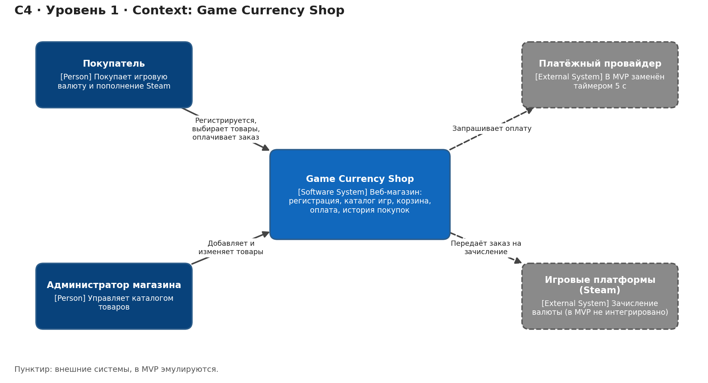
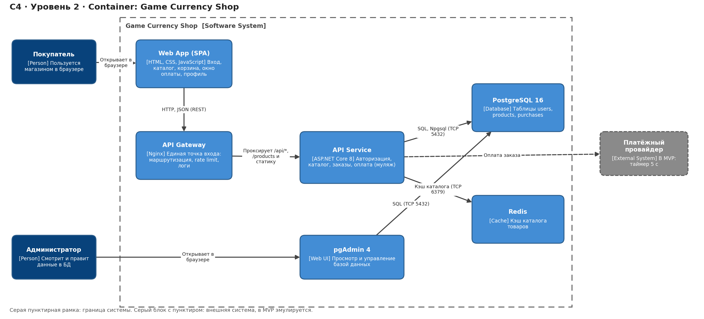
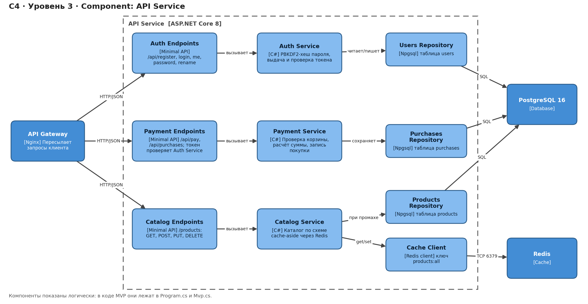

# Архитектура Game Currency Shop

## Описание системы

Game Currency Shop — веб-магазин внутриигровой валюты и пополнения Steam. Покупатель регистрируется, ищет игру, собирает корзину, оплачивает заказ (оплата учебная, вместо банка работает таймер 5 секунд) и видит историю своих покупок. Администратор управляет каталогом товаров.

**Основной сценарий:** регистрация → каталог → корзина → окно оплаты → «Заказ оплачен» → запись покупки в базе → история покупок в профиле.

Схемы: `c4-1-context.png`, `c4-2-container.png`, `c4-3-component.png` (то же одним файлом: `architecture.pdf`). Редактируемый исходник: `game-shop-c4.drawio` (открывается в draw.io, три листа).

## Уровень 1. Context



| Участник | Роль |
|---|---|
| Покупатель | Регистрируется, выбирает товары, оплачивает заказ |
| Администратор магазина | Добавляет и изменяет товары |
| Game Currency Shop | Вся система как «чёрный ящик» |
| Платёжный провайдер | Внешняя система оплаты. В MVP заменена таймером 5 с |
| Игровые платформы (Steam) | Внешняя система зачисления валюты. В MVP не интегрирована |

## Уровень 2. Container



| Контейнер | Технология | Задача |
|---|---|---|
| Web App (SPA) | HTML, CSS, JavaScript | Интерфейс: вход, каталог, корзина, окно оплаты, профиль |
| API Gateway | Nginx | Единая точка входа: маршрутизация, ограничение частоты запросов, логи |
| API Service | ASP.NET Core 8 | Бизнес-логика: авторизация, каталог, оплата, история покупок |
| PostgreSQL 16 | PostgreSQL | Основная база: пользователи, товары, оплаченные покупки |
| Redis | Redis | Кэш каталога товаров |
| pgAdmin 4 | pgAdmin | Просмотр и управление базой администратором |

Взаимодействие: браузер → Gateway (HTTP, JSON) → API Service → PostgreSQL (SQL по TCP 5432) и Redis (TCP 6379). В Docker Compose сервисы находятся в одной сети и обращаются друг к другу по имени (`db`, `redis`), а не по `localhost`.

## Уровень 3. Component (API Service)



| Компонент | Задача |
|---|---|
| Auth Endpoints | `/api/register`, `/api/login`, `/api/me`, `/api/password`, `/api/rename` |
| Payment Endpoints | `/api/pay`, `/api/purchases` (токен проверяет Auth Service) |
| Catalog Endpoints | `/products`: чтение, создание, изменение, удаление товаров |
| Auth Service | PBKDF2-хеш пароля, выдача и проверка токена входа |
| Payment Service | Проверка корзины, расчёт суммы на сервере, запись покупки |
| Catalog Service | Отдаёт каталог по схеме cache-aside: сначала Redis, при промахе база |
| Users / Purchases / Products Repository | Доступ к таблицам через Npgsql |
| Cache Client | Чтение и запись кэша каталога в Redis |

Компоненты показаны логически: в коде MVP они лежат в `Program.cs` и `Mvp.cs`.

## Почему выбраны эти компоненты

- **API Service (ASP.NET Core 8).** Один сервис достаточно для магазина такого размера: микросервисы добавили бы сложность без пользы (подход «модульный монолит»).
- **PostgreSQL.** Пользователи и покупки связаны между собой и требуют целостности данных (внешний ключ `purchases.user_id → users.id`, транзакции), поэтому нужна реляционная база. Состав заказа хранится в колонке JSONB.
- **Redis cache.** Каталог товаров читают чаще всего и меняют редко. Кэш снижает нагрузку на PostgreSQL и ускоряет главную страницу. При изменении товара (POST, PUT, DELETE) кэш сбрасывается. Очередь не нужна: оплата выполняется сразу, а не в фоне. Файловое хранилище не нужно: картинок товаров пока нет.
- **API Gateway (Nginx).** Клиент знает один адрес и не зависит от внутренней структуры. Gateway принимает все запросы, ограничивает частоту (защита входа от перебора пароля) и ведёт логи. Если API Service понадобится запускать в нескольких копиях, этот же Nginx сможет балансировать нагрузку.

## Что реализовано в MVP

| Часть | Статус |
|---|---|
| Web App, API Service, PostgreSQL, pgAdmin | Работают в Docker Compose |
| API Gateway (Nginx) | Работает: единственная точка входа на порту 8080. Для `/api/login` и `/api/register` включено ограничение частоты: 10 запросов в минуту с одного адреса (плюс запас 5), дальше ответ 429 |
| Redis | Работает: каталог `/products` кэшируется на 5 минут, при добавлении, изменении и удалении товара кэш сбрасывается. Заголовок ответа `X-Cache` показывает `HIT` (из Redis) или `MISS` (из PostgreSQL) |
| Платёжный провайдер, Steam | Эмулируются: оплата заменена таймером 5 секунд, зачисление валюты не выполняется |

## Как проверить

```
docker compose ps
curl.exe -s -D - -o NUL http://localhost:8080/products | findstr X-Cache
docker compose exec redis redis-cli KEYS "*"
docker compose logs gateway
```

Первый запрос к `/products` возвращает `X-Cache: MISS`, второй `X-Cache: HIT`. После добавления товара снова `MISS`.
