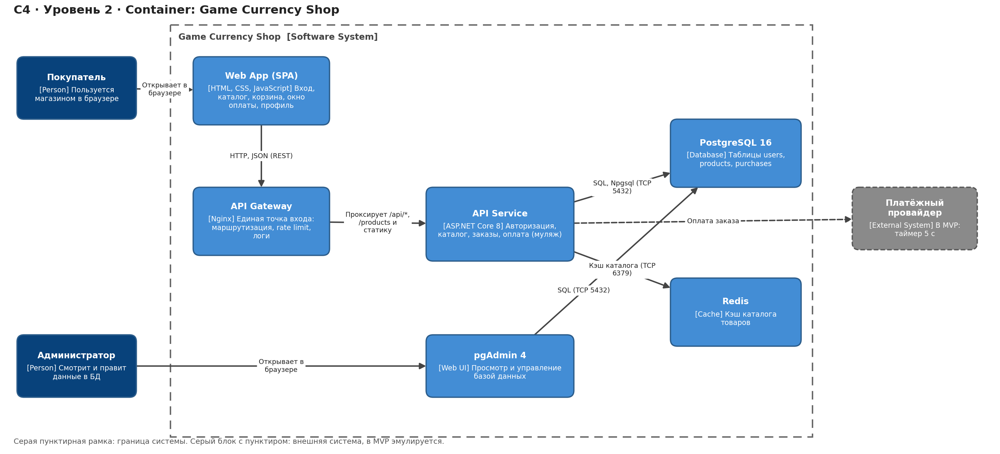

# Game Currency Shop

игровой магазин для покупки внутриигровой валюты и пополнения баланса

## Планируемый функционал
- каталог товаров
- оформление заказа
- просмотр истории заказов

## Конфликт
При слиянии ветки feature/project-notes в main возник конфликт в README.md — обе ветки (feature/readme-update и feature/project-notes) изменили одну и ту же строку с описанием проекта. Конфликт был разрешён вручную.

## Граф веток
См. файл network graf.png 

## Документация

- [Архитектура](architecture/architecture.md): схемы C4 (Context, Container, Component), описание компонентов и пояснение выбора
- [Схемы в PDF](architecture/architecture.pdf)
- [Исходник схем (.drawio)](architecture/game-shop-c4.drawio)
- [Запуск проекта](GameShopApi/README.md)

## Архитектура

